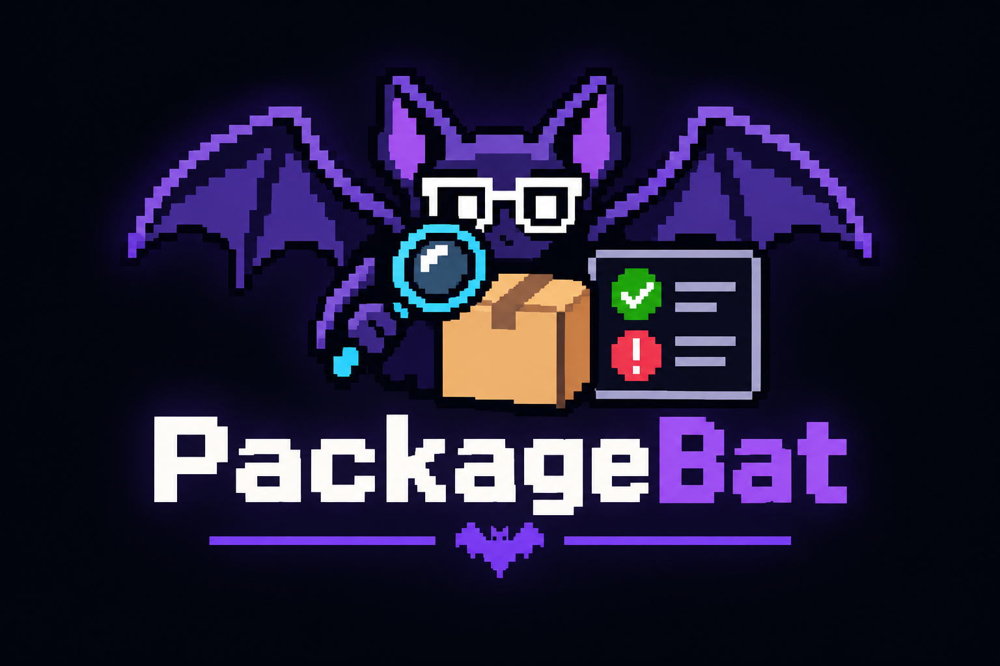

<p align="center">
  
</p>

<p align="center"><b>Dependabot tells you a new version exists. PackageBat tells you what it breaks in <i>your</i> code.</b></p>

---

PackageBat compares a dependency's public API between the version you have and the version a PR bumps it to, then cross-checks that against the APIs your code actually calls. Instead of a changelog to read, you get:

> ❌ **This bump changes 12 APIs you use, in 2 files.** (11 breaking, 1 fixed by recompiling)

| | API | Change | Where you use it |
|---|---|---|---|
| ❌ | `Command.AddOption(Option)` | Removed | `src/TodoCli/Program.cs:12`<br>`src/TodoCli/Program.cs:17` |
| ❌ | `System.CommandLine.Handler` | Type removed (you use SetHandler) | `src/TodoCli/Program.cs:13`<br>`src/TodoCli/Program.cs:18` |
| ❌ | `new Argument<T>(string, string)` | Signature changed. Now: new Argument&lt;T&gt;(string) | `src/TodoCli/Program.cs:6` |
| 🔁 | `new Option<T>(string, string)` | Signature changed, but existing calls still compile (new optional or params parameters)… | `src/TodoCli/Program.cs:7` |
| … | | | |

*(Real output for a small app bumping System.CommandLine 2.0.0-beta4 → 2.0.0. The lines it flags are exactly the lines the compiler rejects after the bump. In a PR comment each location is a link.)*

Library authors have API-compat tools. PackageBat is the consumer side.

## Use it as a GitHub Action

Add `.github/workflows/packagebat.yml` (also in [`examples/packagebat.yml`](examples/packagebat.yml)):

```yaml
name: Dependency blast radius
on:
  pull_request:
    paths: ['**/*.csproj', '**/*.fsproj', '**/*.vbproj', '**/*.props', '**/*.targets', '**/packages.config']

permissions:
  contents: read
  pull-requests: write   # to post the report (works for Dependabot PRs too)

jobs:
  blast-radius:
    runs-on: ubuntu-latest
    steps:
      - uses: actions/checkout@v4
        with:
          fetch-depth: 0
      - uses: Moonwalker1307/PackageBat@main
        with:
          fail-on: breaking   # or 'none' to only comment
```

On every PR that changes a package version (Dependabot, Renovate or by hand) it:

1. finds the version changes by reading your project files before and after the PR (`PackageReference`, central `Directory.Packages.props`, `packages.config`);
2. builds your code as it was **before** the bump, which still compiles;
3. downloads both package versions and compares their public APIs;
4. scans your compiled assemblies for every reference into the package and maps each one to a file and line through the PDB;
5. posts one PR comment (updated on each push) and writes the job summary; optionally fails the check.

| Input | Default | |
|---|---|---|
| `project` | *(auto)* | Solution or project to build. By default the one at the root, else the only `.sln`, else every project. |
| `build-args` | | Extra `dotnet build` arguments. |
| `dotnet-version` | `8.0.x` | SDKs to install (one per line). Add yours if your code targets something newer. |
| `fail-on` | `none` | `breaking`, `binary` or `warning`: fail when used changes reach this level. |
| `threshold` | `0` | Only fail when more than this many used changes reach `fail-on`. |
| `coverage` | | Opt-in. Cobertura coverage file(s) from your tests, one path or glob per line. See [Test coverage](#test-coverage-opt-in). |
| `comment` | `true` | Post the report as a PR comment. |
| `base-ref` | PR base | What to compare against. |

Outputs: `breaking`, `used-changes`, `untested` (with `coverage`: affected call sites your tests never run), `report` (Markdown path), `report-json`.

### Test coverage (opt-in)

Give PackageBat a Cobertura coverage file and the report also says whether your tests run each affected line: a summary such as "2 of 3 affected call sites are never run by your tests", a *Run by tests* column, and `(untested)` after each location no test reaches. It only reads the file; producing it is up to you, in a step before PackageBat.

Run the tests on the PR's **base** commit. That is the code PackageBat analyses, so the line numbers match, and it still compiles even when the bump breaks the build:

```yaml
      - name: Test coverage before the bump
        env:
          BASE: ${{ github.event.pull_request.base.sha }}
        run: |
          git worktree add "$RUNNER_TEMP/base" "$(git merge-base "$BASE" HEAD)"
          dotnet test "$RUNNER_TEMP/base" --collect "XPlat Code Coverage" --results-directory "$RUNNER_TEMP/coverage"
      - uses: Moonwalker1307/PackageBat@main
        with:
          coverage: ${{ runner.temp }}/coverage/**/coverage.cobertura.xml
```

`XPlat Code Coverage` comes from the `coverlet.collector` package, which `dotnet new xunit`/`nunit`/`mstest` projects already reference. Any Cobertura file works (ReportGenerator, coverage.py, istanbul...), and several files are added up. Paths are matched on their end, so coverage made in another checkout or on another machine still lines up.

A covered line is one that ran during the tests. That doesn't prove a test checks what the line does, so treat ✅ as "something would probably have noticed" and ❌ as "nothing will".

## Use it from the command line

```bash
dotnet tool install --global PackageBat

# one package, against your built code
packagebat analyze --package System.CommandLine --from 2.0.0-beta4.22272.1 --to 2.0.0 --consumer src

# whatever changed between two git revisions
packagebat analyze --base origin/main --consumer . --markdown report.md --json report.json --fail-on breaking
```

Add `--coverage coverage.cobertura.xml` (repeatable) to `analyze` to include test coverage.

`--consumer` takes built assemblies or folders to search (anything with a `.pdb` next to it, `obj/` skipped). Run `packagebat help` for all options. Exit codes: `0` ok, `1` error, `2` over the `--fail-on` threshold.

## What it detects

| Severity | Change | Hits you when you… |
|---|---|---|
| ❌ Breaking | Type removed or moved (with where it went) | use the type at all |
| ❌ Breaking | Member removed | call it, read it, or override it |
| ❌ Breaking | Signature changed (parameter, return or property type, static ↔ instance) | call it |
| ❌ Breaking | New member on an interface / new abstract member | implement or derive from it |
| ❌ Breaking | Class sealed or its constructors hidden | derive from it |
| ❌ Breaking | `[Obsolete(..., error: true)]` added | use it |
| 🔁 Recompile | Only optional or `params` parameters added | call it (old binaries break; source still compiles, so check the new parameters mean what you expect) |
| ⚠️ Warning | `[Obsolete]` added | use it |

Changes that don't touch your code are listed in a collapsed section, so you can still see the whole picture.

**Why compiled code?** The compiler has already resolved overloads, extension methods, generics and implicit conversions, so PackageBat sees exactly which member each line binds to, with no guessing from source text.

**Not detected (yet):** behaviour changes behind an unchanged signature; changes in a package's *dependencies* (each bumped package is analysed on its own); overrides of members on generic base classes where the signature uses the base's type parameters; version numbers set through MSBuild properties.

## Other languages

Only the `Ecosystems/` folder knows about .NET. Everything else (the diff, matching usages to changes, the report, the Action's comment) works on a small language-neutral JSON format:

- **API surface**: `packagebat api --package X --version 1.2.3` → types, members with a join `key`, parameters, deprecation.
- **Usages**: `packagebat usages --package X --version 1.2.3 --consumer bin/` → `{ typeName, memberKey, kind, location: { file, line } }`.
- **Analyze**: `packagebat analyze --old-api old.json --new-api new.json --usages usages.json` runs on JSON alone.

So adding TypeScript, Java or Python means writing an extractor and a usage scanner (in any language) that emit those two files, or implementing [`IEcosystem`](src/PackageBat/Ecosystems/IEcosystem.cs) in-process. The rules for the join key are at the top of [`ApiSurface.cs`](src/PackageBat/Model/ApiSurface.cs).

## Layout

```
src/PackageBat/
  Model/        language-neutral API, usage and report types (the JSON format)
  Analysis/     ApiDiff (old vs new API), UsageMatcher (your usages vs the diff), LineCoverage (Cobertura)
  Report/       Markdown for PR comments
  Ecosystems/   IEcosystem + DotNet/ (NuGet download, metadata API extractor, IL+PDB usage scanner, bump detector)
action.yml, action/run.sh   the GitHub Action
tests/PackageBat.Tests/   end-to-end tests that compile two library versions and a consumer in memory
tests/PackageBat.Fuzz/    fuzz and property tests (see below)
```

## Fuzzing

`tests/PackageBat.Fuzz` uses [CsCheck](https://github.com/AnthonyLloyd/CsCheck) to throw corrupted package and consumer assemblies, corrupted PDBs, corrupted JSON (through `packagebat analyze`) and junk project files at PackageBat, and checks properties of the diff and matcher on random API surfaces. In normal CI each target runs a few hundred inputs; the [Fuzz workflow](.github/workflows/fuzz.yml) runs every night for longer and can be started by hand.

```bash
FUZZ_SECONDS=60 dotnet test tests/PackageBat.Fuzz           # one minute per target
FUZZ_SEED=<seed> dotnet test tests/PackageBat.Fuzz --filter <test>   # replay a failure
```

Inputs that crash a target are saved under `fuzz-findings/` (the workflow uploads them as an artifact).

## License

MIT
